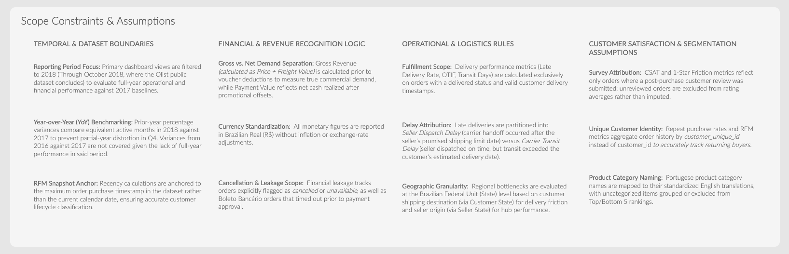
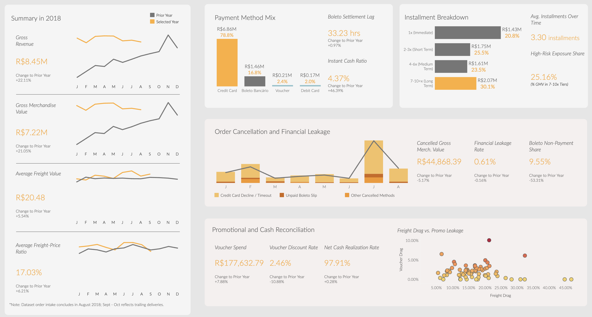
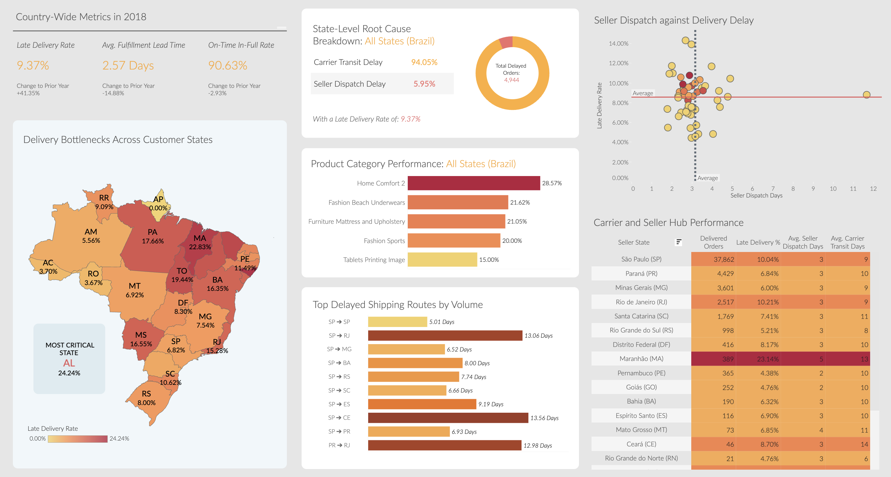
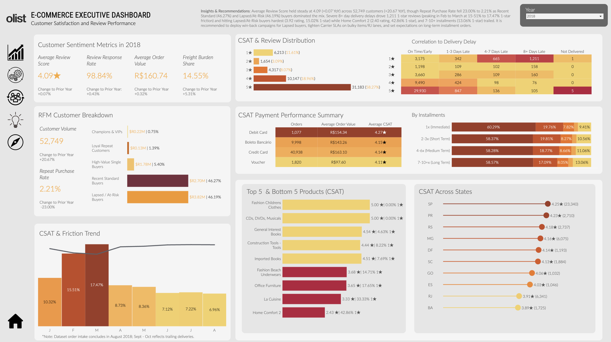

# Olist E-Commerce Executive Intelligence Suite (2016–2018)


### Author: Luis Rafael R. Javier | luisrafaelr.javier@gmail.com
Date: November 21, 2026

> **[View Live Interactive Dashboard on Tableau Public →]([https://public.tableau.com:9443/views/OlistE-CommerceExecutiveIntelligenceSuite11_15_2026/0_HomePage)**

This is an end-to-end business intelligence and data analytics portfolio project analyzing **~99,400 distinct orders** across the Brazilian e-commerce marketplace (**Olist**), in the 2018 reporting period using 2017 as baseline. Using **PostgreSQL** and **Tableau**, this six-tab executive suite evaluates revenue and merchandise quality, financial leakage, cash realization velocity, fulfillment bottlenecks across product categories and shipping routes between customer states, and satisfaction drivers among customer RFM segments.


---

## Business Context & Core Objectives

Operating as a multi-seller marketplace across Brazil's vast geographic corridors creates compounding operational and financial friction from deferred installment cash flows and heavy regional freight burdens to long-haul linehaul delays that erode customer satisfaction.

This suite was designed to answer three strategic questions for executive leadership:
1. **Financial Health & Cash Realization:** How much top-line GMV converts into immediate, realized net cash versus being deferred through installment plans, lost to *Boleto Bancário* expirations, or eroded by freight and promotional voucher leakage?
2. **Operational & Logistics Attribution:** Are delivery delays driven primarily by slow merchant dispatch or carrier transit bottlenecks, and which shipping corridors and product lines require targeted SLA intervention?
3. **Customer Satisfaction & Lifecycle Retention:** Where is the critical delivery-delay tipping point for Customer Satisfaction (CSAT), and how effectively is marketplace acquisition converting into high-value repeat cohorts?

---

## Scope Constraints and Assumptions



### Dataset Coverage and Temporal Boundaries
The analysis evaluates approximately 99,400 distinct orders placed on the Brazilian e-commerce marketplace Olist between September 2016 and October 2018. Because 2016 represents an early platform ramp-up period with partial monthly coverage and sparse order volume, all year-over-year (YoY) growth comparisons and run-rate benchmarks are anchored to full-year 2018 vs. 2017 performance rather than 2016 baselines.

### Order Lifecycle and Reconciliation Scope
To ensure strict analytical parity between PostgreSQL validation scripts and Tableau dashboards, primary commercial, operational, and sentiment KPIs are scoped exclusively to completed transactions where **order_status = 'delivered'**. Non-delivered statuses **(canceled, unavailable, invoiced, shipped, processing, and approved)** are excluded from realized revenue and fulfillment SLA calculations, and are isolated specifically within the Financial Leakage module to quantify cancelled merchandise exposure. 

### Grain Control & Anti-Fan-Out Governance
Because Olist orders frequently contain multiple line items and split payment methods (such as combined credit card and voucher payments), joining order items directly to payments introduces many-to-many fan-out inflation. All SQL staging models and Tableau calculated fields enforce strict grain separation, aggregating item-level values such as GMV and Freight at the order-item grain and payment values such as installments and net cash realization at the order-payment grain, before joining to the central order fact table. 

### Operational SLA & Logistics Attribution Logic
Delivery performance metrics rely on verified timestamp milestones rather than carrier-reported status flags:

 * **Fulfillment Lead Time**: Measured from approval date of order *(order_approved_at)* to date of customer delivery *(order_delivered_customer_date)*, capturing merchant preparation and handoff speed.

 * **Last-Mile & Total Transit Duration**: Measured from purchase order timestamp *(order_purchase_timestamp)* to the date of customer delivery *(order_delivered_customer_date)*.

 * **Late Delivery Attribution**: An order is classified as late whenever *order_delivered_customer_date* exceeds *order_estimated_delivery_date*. Delays are attributed to **Seller Dispatch** if the merchant missed the *shipping_limit_date* and to **Carrier Transit** if the seller handed off the package on time but final customer delivery missed the estimated date.

### Customer Identity, RFM & Sentiment Assumptions
* **Unique Customer Resolution**: Because *customer_id* in the raw Olist schema is generated per order, all customer-level retention and RFM (Recency, Frequency, Monetary) metrics are aggregated on *customer_unique_id* to accurately track repeat purchasing behavior across transactions.

* **Currency & Tax Normalization**: All monetary metrics are reported in nominal Brazilian Reais (R$) as recorded at checkout, without external inflation adjustments or post-sale marketplace commission deductions (as seller take-rate schedules are not included in the public dataset). 

---
## Executive Summary & Key Findings (2018 Benchmark)

### 01 | Financial Summary & Performance


### 01.A | Top-Line Demand & Freight Economics
In 2018, the commercial top line of Olist matured into a steadier, predictable monthly run rate compared to 2017's volatile ramp-up, with Gross Revenue growing ***+22.11% YoY*** to R$ 8.45M and Gross Merchandise Value (GMV) expanding ***+21.05% YoY*** to R$ 7.22M. However top-line growth outpaced shipping efficiency: Average Freight Value has increase +5.54% YoY to R$ 20.48, which pushes the Average Freight-Price-Ratio to 17.03% ***(+6.21% YoY)***. This widening freight drag indicates that shipping costs are absorbing a greater share of customer basket value, particularly on smaller or single-item orders. 

### 01.B | Payment Mix & Settlement Velocity
Checkout volume remained heavily anchored by Credit ***(78.8% share at R$6.86M)*** and Boleto Bancário ***(16.8% share at R$1.46M)***, while Voucher ***(2.4% share at R$0.21M)*** and Debit ***(2.0% at R$0.17M)*** accounted for the remaining volume. Boleto transactions carried an average settlement lag of 33.23 hours ***(+0.97% YoY)*** between purchase approval and payment clearance delaying working capital availability. On the other hand, Instant Cash Ratio (which measures the immediate settlement via Debit Card and 1-installment Credit Card checkouts) has jumped to 4.37% ***(+46.39% YoY)***. This reflects the growing adoption among buyers for immediate payment options.

### 01.C: Installment Behavior & Credit Exposure
Customers averaged 3.30 installments across qualifying credit card transactions. While 1x-3x short-term plans captured the largest combined shares of installment volume at 46.3% (R$3.18M), extended credit remains a major working-capital concentration: 7-10+x long-term installment tiers accounted for ***30.1% (R$2.07M)***, placing 25.16% of total GMV in high-risk, long-dated receivable exposure that slows cash realization.

### 01.D | Financial Leakage & Seasonal Anomalies
Platform-wide Financial Leakage improved by 0.16 percentage points YoY to 0.61% of GMV, totaling R$44.9K in cancelled merchandise value ***(-5.17% YoY)***, where the monthly cancelled GMV was recorded high in the month of July ***(R$ 17, 5K at 1.95% leakage)***, triggered primarily by credit card declines, unpaid boleto slips, and other cancellation reasons. 

### 01.E | Voucher Dilution & Net Cash Realization
Total Voucher Spend grew +7.88% YoY to R$177.6K, which represents a 2.46% Voucher Discount Rate against GMV ***(-10.88% YoY)***. Even with rising promotional spend, platform-wide Net Cash Realization remained healthy at 97.91% ***(+0.28% YoY)***. At the category level, promotional dilution was heavily concentrated in specific verticals, most notable is in Fashion Female Clothing, with the lowest recorded net cash realization rate at 89.95%.

* **Strategic Recommendations:**
  * **Introduce Tiered Free-shipping Thresholds** - Set a minimum car threshold roughly 15%-20% above current average order values rather than subsidizing shipping on small single-item baskets. By encouraging multi-item bundling in orders, this lifts basket size and naturally dilutes the current 17.03% FPR without compressing product margins.

  * **Incentivize Short-term/Immediate Payments** - Offer a targeted 2%-3% instant-checkout discount or loyalty credit for Debit Card and 1-3x Credit Card payments while restricting 7-10+x installment plans to higher-ticket categories. This will build on the 46.39% surge in Instant Cash Ratio and reduces the R$2.07M  locked in long-term installment exposure.
 
  * **Automate Boleto Expiration Reminders** - Trigger automated SMS, WhatsApp, or email nudges at 12 and 24 hours post-checkout, paired with one-click card-switch or slip-renewal links. Proceeding with this will compress the 33.23-hour settlement lag, lower the 9.55% Boleto non-payment rate, and prevent seasonal spikes like July 2018's 1.95% leakage surge.

  * **Audit High-Leakage Category Promotions** - Establish stricter guardrails on stackable voucher codes and margin-dilutive discounting in categories like Fashion Female Clothing ***(89.95% realization)*** so underperforming verticals move closer to the 97.91% platform realization benchmark. 

---

### 02 | Operational Metrics & Delivery Performance


### 02.A | Nationwide Delivery Reliability & Fulfillment Speed
In 2018, Olist improved upstream warehouse efficiency, with Average Fulfillment Lead Time dropping 14.88% to 2.57 days. However, overall delivery reliability has deteriorated downstream as the nationwide Late Delivery Rate surged to 9.37% ***(+41.35% YoY)***. This represents a total of 4,944 delayed orders, which pulled the platform's On-Time In-Full (OTIF) rate down to 90.63% ***(-2.93% YoY)***. This divergence highlights that while sellers handed packages over faster than in 2017, last-mile and interstate transit networks struggled to keep pace with higher 2018 order volumes. 

### 02.B | Delay Root-Cause Attribution (Carrier Transit vs. Seller Dispatch)
Breakdown the 4,944 delayed orders reveals a clear operational bottleneck: Carrier Transit Delays accounted for 94.05% of all late deliveries, whereas Seller Dispatch Delays contributed only 5.95%. Because seller dispatch lag was minimal and fulfillment lead time improved YoY, delivery failures were overwhelmingly driven by third-party logistics (3PL) line-haul congestion, regional sorting bottlenecks, and unrealistic checkout transit-time estimates rather than merchant preparation delays. 

### 02.C | Geographic & State-Level Delivery Bottlenecks
Delivery performance varied dramatically by destination region, with norther and northeastern states experiencing severe SLA breakdowns compared to the southeastern core. Alagoas recorded the highest Late Delivery Rate at 24.24%, followed closely by Maranhão at 22.83% and Ceará at 21.01%, more than double the national average of 9.37%. While southeastern hubs like São Paulo benefited from dense local carrier coverage and shorter transit distances, long-haul shipments out of the southeast suffered acute line-haul friction once crossing into the Northeast. 

### 02.D | High-Volume Corridor & Hub SLA Performance
Corridor-level diagnostics confirm that high-volume interstate lanes originating from São Paulo (SP) drove the bulk of cumulative transit lag. Major commercial corridors such as SP to RJ averaged 13.06 days in total delivery duration, while long-haul routes like SP to CE stretched to 13.65 days. Heavy reliance on centralized São Paulo fulfillment without intermediate regional cross-docking hubs compounded transit exposure on both neighboring high-density corridors and distant interstate lanes. 

* **Strategic Recommendations:**
  * **Renegotiate Regional 3PL SLAs & Diversify Carriers** - Establish performance-tiered contracts and backup carrier routing specifically for high-failure Northeast destinations, targeting Alagoas (24.24%), Maranhão (22.83%), and Ceará (21.01%) to reduce the 94.05% share of delays caused by carrier transit bottlenecks.
 
  * **Recalibrate Checkout Delivery Buffers on Long-Haul Lanes** - Dynamically pad estimated delivery dates at checkout for historically congested corridors such as SP to RJ (13.06 days) and SP to CE (13.56 days). Setting accurate expectations upfront prevents artificial SLA misses and protects downstream customer satisfaction without slowing actual fulfillment.
 
  * **Decentralize Inventory Into Regional Fulfillment Hubs** - Incentivize high-volume merchants to pre-position fast-moving SKUs in secondary distribution centers outside São Paulo (Such as Rio de Janeiro and key Northeast hubs) to shorten line-haul distances and restore platform OTIF above 93%. 

---

### 03 | Customer Satisfaction & Review Performance


### 03.A | Overall Sentiment & review Polarity
Across 2018 delivered orders, Olist maintained an overall Average Review Score of 4.09 out of 5.00, supported by a 77.23% Positive Sentiment Share (combining 4 and 5-star ratings). Rather than clustering around neutral ratings, customer feedback exhibited strong bimodal polarity: 5-star reviews anchored the majority of volume, while dissatisfied buyers overwhelmingly left 1-star ratings rather than 2- or 3-star scores, demonstrating that checkout and fulfillment experiences tend to generate either strong advocacy or acute detraction.

### 03.B | Delivery Delay Sensitivity & Review Erosion
Logistics reliability proved to be the signle strongest operational driver of customer sentiment. Roughly 83.13% of Orders delivered on or before their promised Estimated Delivery Date received a positive rating (4 to 5), whereas 69.16% to 80.15% of deliveries that are 4+ days past their estimated delivery date experience severely low ratings (1 to 2-stars). Satisfaction erosion accelerated sharply once delays crossed the 1-to-3 day threshold, proving that uncommunicated carrier transit delays directly convert otherwise satisfied buyers into 1-star detractors.

### 03.C | RFM Customer Segmentation & Retention Value
RFM segmentation revealed a highly concentrated core of repeat and high-value buyers alongside a large single-purchase base. Top-tier segments (Champions and Loyal Customers) generated disproportionate revenue per customer and consistently recorded higher average review scores than one-time buyers. Conversely, At-Risk and Lapsed segments showed elevated concentrations of past delivery delays and 1-star friction, indicated that unresolved fulfillment failures are a primary dirver of customer churn after an initial order.

### 03.D | Category-Level Sentiment & Product Quality Outliers
While high-volume core categories such as Health & Beauty and Bed, Bath & Table sustained steady ratings near or above the 4.09 platform benchmark, specific niche verticals experienced pronounced review drag. Categories such as Office Furniture and Security & Services posted notably lower average review scores and higher detractor shares, driven bulky-item transit damage, longer assembly/fulfillment cycles, and expectation mismatches between product listings and delivered goods. 

* **Strategic Recommendations:**
  * **Trigger Proactive Delay Recovery & Micro-Vouchers** - Automatically notify customers via WhatsApp or email the moment a shipment falls behind carrier milestones (before the EDD passes) and pair high-delay orders (>3 Days late) with an automated R$10-15 recovery voucher to cushion the low review penalty.
 
  * **Launch Targeted Win-Back Campaigns for At-Risk RFM Tiers** - Segment At-Risk and Hibernating customers who previously experienced a late delivery or left a 1-to-2-star review, targeting them with personalized re-engagement offers backed by priority shipping guarantees.

  * **Enforce Merchant * Category Quality Audits on High-Detractor Verticals** - Require enhanced packaging standards, clearer dimensional specs, and stricter seller SLA thresholds in low-scoring categories like Office Furniture to curb transit damage and lift category ratings closer to the 4.09 platform baseline.
 
  * **Convert Champions & Loyal RFM Tiers Into Brand Advocates** - Introduce a post-delivery referral or tiered loyalty perk exclusively for Champions and Loyal Customers to maximize repeat purchase frequency and compound organic acquisition.

---

## Data Architecture & Technical Methodology

### 1. Relational Data Modeling (PostgreSQL)
* **Grain Alignment & Fan-Out Prevention:** In the raw Olist schema, `order_items` (item-level grain) and `order_payments` (payment-installment grain) have a many-to-many relationship per `order_id`. Joining them directly inflates revenue and freight metrics. Data was cleaned, normalized, and structured into grain-aligned tables in PostgreSQL prior to ingestion.
* **Geographic & Category Normalization:** Standardized Brazilian state codes (`customer_state`, `seller_state`) with full state name lookups and mapped Portuguese product categories to standardized English business groupings.

### 2. Visual & Analytical Engineering (Tableau)
* **Proportional Net Cash Realization (Fixed LODs):** Engineered Level of Detail (`FIXED`) expressions to proportionally allocate order-level voucher deductions across product categories, preventing cross-grain distortion when evaluating category-level net cash realization.
* **Quadrant Bottleneck Diagnostics:** Built a dual-reference scatter plot mapping **Seller Dispatch Latency** against **Delivery Delay**, isolating *Dual Bottlenecks* (slow seller + late arrival) from *Carrier Linehaul Bottlenecks* (fast seller + late arrival) and *Buffer-Absorbed Delays*.
* **Custom RFM Customer Segmentation:** Classified the customer base into five actionable cohorts (*Champions & VIPs*, *Loyal Repeat Customers*, *High-Value Single Buyers*, *Recent Standard Buyers*, and *Lapsed / At-Risk Buyers*) using dynamic Recency, Frequency, and Monetary thresholds.
* **1920×1080 Executive Layout Architecture:** Designed using fixed pixel container coordinates, parameter-driven dynamic year filtering (`[Selected Year]`), custom percentage number formatting, and interactive navigation rails.

### 3. Data Coverage & Scope Note
> **Dataset Cutoff Caveat:** Historical order intake in the Olist dataset begins in **September 2016** (sparse initial staging volume) and concludes at the end of **August 2018**. Data points appearing in **September–October 2018** reflect trailing order deliveries and post-cutoff dispute reviews rather than new marketplace order volume.

---

## Repository Structure

```text
olist-ecommerce-executive-analytics/
├── README.md 	               # Project overview, executive insights, recommendations & methodology
│   
├── data/
│   ├── raw_tables             # Original imported datasets (.csv) directly downloaded from KaggleHub Olist E-Commerce
│   │   ├── olist_customers_dataset.csv
│   │   ├── olist_geolocation_dataset.csv
│   │   ├── olist_order_items_dataset.csv
│   │   ├── olist_order_payments_dataset.csv
│   │   ├── olist_order_reviews_dataset.csv
│   │   ├── olist_orders_dataset.csv
│   │   ├── olist_products_dataset.csv
│   │   ├── olist_sellers_dataset.csv
│   │   ├── olist_customers_dataset.csv
│   │   └── product_category_name_translation.csv
│   │
│   ├── cleaned_tables         # Final datasets (dimensions, facts, and lookups) after ETL processing.
│   │   ├── dim_customers.csv
│   │   ├── dim_customerstates.csv
│   │   ├── dim_geolocation.csv
│   │   ├── dim_productcategoryname.csv
│   │   ├── dim_products.csv
│   │   ├── dim_sellers.csv
│   │   ├── fact_orderitems.csv
│   │   ├── fact_orderpayments.csv
│   │   ├── fact_orderreviews.csv
│   │   └── fact_orders.csv
│   │
│   └── information_tables     # Additional information tables for Data Dictionary, RFM Customer Segmentation and Customer States Reference
│       ├── Business Metrics for Executive Summary.csv
│       ├── customer_state_translation.csv
│       └── RFM Customer Segmentation Rules.csv
│
├── sql/
│   ├── 00_Schema_and_Staging.sql                              # Relational setup, null handling & lookup mappings
│   ├── 01_KPI_Validation_and_EDA_on_Financial_Tab.sql         # Grain-aligned fact modeling & SLA latency metrics
│   └── 02_KPI_Validation_and_EDA_on_Operations_Tab.sql        # Grain-aligned fact modeling & SLA latency metrics
|   └── 03_KPI_Validation_and_EDA_on_CSAT_and_Review_Tab.sql   # RFM cohort definitions & KPI validation # RFM cohort definitions & KPI validation queries
│
├── tableau/
│   └── Olist E-Commerce Executive Intelligence Suite.twbx     # Packaged Tableau workbook with embedded extracts
│
└── assets/
    ├── 00_Home_Page.png                      # Home Tab
    ├── 01_Financial_Summary.png              # Financial Summary & Performance Tab
    ├── 02_Operations_Summary.png             # Operational Metrics & Delivery Performance Tab
    ├── 03_CSAT_Summary.png                   # Customer Satisfaction & Review Performance Tab
    ├── 04_Navigation_and_Constraints.png     # Project Scope - Navigation Architecture & Scope Constraints Tab
    └── 05_Data_Dictionary_Calculations.png   # Project Scope - Data Dictionary & Calculations Tab
