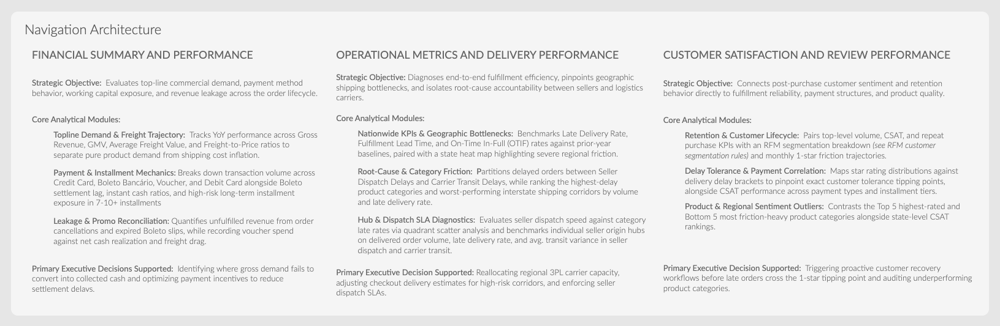

# Olist E-Commerce Executive Intelligence Suite (2016–2018)


> **[View Live Interactive Dashboard on Tableau Public →](https://public.tableau.com:9443/views/OlistE-CommerceExecutiveIntelligenceSuite11_15_2026/0_HomePage?:language=en-US&:sid=&:redirect=auth&:display_count=n&:origin=viz_share_link)**

This is an end-to-end business intelligence and data analytics portfolio project analyzing **~99,400 distinct orders** across the Brazilian e-commerce marketplace (**Olist**), in the 2018 reporting period using 2017 as baseline. Using **PostgreSQL** and **Tableau**, this six-tab executive suite evaluates revenue and merchandise quality, financial leakage, cash realization velocity, fulfillment bottlenecks across product categories and shipping routes between customer states, and satisfaction drivers among customer RFM segments.



---

## Business Context & Core Objectives

Operating as a multi-seller marketplace across Brazil's vast geographic corridors creates compounding operational and financial friction from deferred installment cash flows and heavy regional freight burdens to long-haul linehaul delays that erode customer satisfaction.

This suite was designed to answer three strategic questions for executive leadership:
1. **Financial Health & Cash Realization:** How much top-line GMV converts into immediate, realized net cash versus being deferred through installment plans, lost to *Boleto Bancário* expirations, or eroded by freight and promotional voucher leakage?
2. **Operational & Logistics Attribution:** Are delivery delays driven primarily by slow merchant dispatch or carrier transit bottlenecks, and which shipping corridors and product lines require targeted SLA intervention?
3. **Customer Satisfaction & Lifecycle Retention:** Where is the critical delivery-delay tipping point for Customer Satisfaction (CSAT), and how effectively is marketplace acquisition converting into high-value repeat cohorts?

---

## Scope Constraints and Assumptions


---

## Executive Summary & Key Findings (2018 Benchmark)

### 01 | Financial Summary & Performance


In 2018, Gross Revenue (+22.11%) and GMV (+21.05%) shifted into a steadier run rate, though Freight-Price Ratio climbed +6.21% to 17.03%. Credit Cards (78.8%) and Boleto (16.8%, 33.23-hr lag) anchored payments, while Instant Cash Ratio jumped 46.39% to 4.37% and 7-10+ installments held 25.16% of GMV risk (R$ 2.07M). Financial leakage fell to 0.61% (Boleto non-payment -53.31% to 9.55%) despite a July spike (at R$17.5K, 1.95%), and Net Cash realization hit 97.91% (lowest recorded in Fashion Female Clothing at 89.95%). 

* **Strategic Recommendations:**
  * Set tiered free-shipping thresholds.
  * Incentivize short-term/immediate payments.
  * Automate Boleto reminders.
  * Audit High-Leakage Category Promotions.

---

### 02 | Operational Metrics & Delivery Performance


In 2018, despite Avg. Fulfillment Lead Time improving 14.88% YoY to 2.57 days, the country-wide Late Delivery Rate surged 41.35% to 9.37% (4,944 delayed orders), lowering OTIF by 2.93% to 90.63% Carrier Transit Delays caused 94.05% of late deliveries (vs. 5.95% seller dispatch), hitting Northeast states hardest, as seen by Alagoas (24.24%, Maranão (22.83%), and Ceará (21.01%), alongside high-volume corridors like São Paulo to Rio De Janeiro (avg. 13.06 days; 1.2K orders) and São Paulo to Ceará (avg. 13.56 days; 715 orders) and bulky items like Home Comfort 2 (28.57%).

* **Strategic Recommendations:**
  * Renegotiate regional 3PL SLAs for Northeast lanes.
  * Pad estimated delivery buffers on long-haul routes.
  * Establish regional fulfillment hubs outside São Paulo.

---

### 03 | Customer Satisfaction & Review Performance


Average Review Score held steady at 4.09 (+0.07 YoY) across 52,749 customers (+20.67 YoY), though Repeat Purchase Rate fell 23.00% to 2.21% as Recent Standard (46.27%) and Lapsed/At-Risk (46.19%) buyers dominated the mix. Severe 8+ day delivery delays drove 1,211 1-star reviews (peaking in Feb to March at 15-51% to 17.47% 1-star friction) and hitting Lapsed/At-Risk buyers hardest (3.92 rating, 15.02% 1-star) while Home Comfort 2 (2.40 rating, 42.86% 1-star), and 7-10+ installments (13.06% 1-star) trailed. It is recommended to deploy win-back campaigns for Lapsed buyers, tighten Carrier SLAs on bulky items/RJ lanes, and set expectations on long-term installment orders.

* **Strategic Recommendations:**
  * Deploy win-back campaigns for Lapsed buyers.
  * Tighten Carrier SLAs on bulky items/RJ lanes.
  * Set expectations on long-term installment orders.

---

## Data Architecture & Technical Methodology

### 1. Relational Data Modeling (PostgreSQL)
* **Grain Alignment & Fan-Out Prevention:** In the raw Olist schema, `order_items` (item-level grain) and `order_payments` (payment-installment grain) have a many-to-many relationship per `order_id`. Joining them directly inflates revenue and freight metrics. Data was cleaned, normalized, and structured into grain-aligned tables in PostgreSQL prior to ingestion.
* **Geographic & Category Normalization:** Standardized Brazilian state codes (`customer_state`, `seller_state`) with full state name lookups and mapped Portuguese product categories to standardized English business groupings.

### 2. Visual & Analytical Engineering (Tableau)
* **Proportional Net Cash Realization (Fixed LODs):** Engineered Level of Detail (`FIXED`) expressions to proportionally allocate order-level voucher deductions across product categories, preventing cross-grain distortion when evaluating category-level net cash realization.
* **Quadrant Bottleneck Diagnostics:** Built a dual-reference scatter plot mapping **Seller Dispatch Latency** against **Delivery Delay**, isolating *Dual Bottlenecks* (slow seller + late arrival) from *Carrier Linehaul Bottlenecks* (fast seller + late arrival) and *Buffer-Absorbed Delays*.
* **Custom RFM Customer Segmentation:** Classified the customer base into five actionable cohorts (*Champions & VIPs*, *Loyal Repeat Customers*, *High-Value Single Buyers*, *Recent Standard Buyers*, and *Lapsed / At-Risk Buyers*) using dynamic Recency, Frequency, and Monetary thresholds.
* **1920×1080 Executive Layout Architecture:** Designed using fixed pixel container coordinates, parameter-driven dynamic year filtering (`[Selected Year]`), custom percentage number formatting, and interactive navigation rails.

### 3. Data Coverage & Scope Note
> **Dataset Cutoff Caveat:** Historical order intake in the Olist dataset begins in **September 2016** (sparse initial staging volume) and concludes at the end of **August 2018**. Data points appearing in **September–October 2018** reflect trailing order deliveries and post-cutoff dispute reviews rather than new marketplace order volume.

---

## Repository Structure

```text
olist-ecommerce-executive-analytics/
├── README.md 	               # Project overview, executive insights, recommendations & methodology
│   
├── data/
│   ├── raw_tables             # Original imported datasets (.csv) directly downloaded from KaggleHub Olist E-Commerce
│   │   ├── olist_customers_dataset.csv
│   │   ├── olist_geolocation_dataset.csv
│   │   ├── olist_order_items_dataset.csv
│   │   ├── olist_order_payments_dataset.csv
│   │   ├── olist_order_reviews_dataset.csv
│   │   ├── olist_orders_dataset.csv
│   │   ├── olist_products_dataset.csv
│   │   ├── olist_sellers_dataset.csv
│   │   ├── olist_customers_dataset.csv
│   │   └── product_category_name_translation.csv
│   │
│   ├── cleaned_tables         # Final datasets (dimensions, facts, and lookups) after ETL processing.
│   │   ├── dim_customers.csv
│   │   ├── dim_customerstates.csv
│   │   ├── dim_geolocation.csv
│   │   ├── dim_productcategoryname.csv
│   │   ├── dim_products.csv
│   │   ├── dim_sellers.csv
│   │   ├── fact_orderitems.csv
│   │   ├── fact_orderpayments.csv
│   │   ├── fact_orderreviews.csv
│   │   └── fact_orders.csv
│   │
│   └── information_tables     # Additional information tables for Data Dictionary, RFM Customer Segmentation and Customer States Reference
│       ├── Business Metrics for Executive Summary.csv
│       ├── customer_state_translation.csv
│       └── RFM Customer Segmentation Rules.csv
│
├── sql/
│   ├── 00_Schema_and_Staging.sql                              # Relational setup, null handling & lookup mappings
│   ├── 01_KPI_Validation_and_EDA_on_Financial_Tab.sql         # Grain-aligned fact modeling & SLA latency metrics
│   └── 02_KPI_Validation_and_EDA_on_Operations_Tab.sql        # Grain-aligned fact modeling & SLA latency metrics
|   └── 03_KPI_Validation_and_EDA_on_CSAT_and_Review_Tab.sql   # RFM cohort definitions & KPI validation # RFM cohort definitions & KPI validation queries
│
├── tableau/
│   └── Olist E-Commerce Executive Intelligence Suite.twbx     # Packaged Tableau workbook with embedded extracts
│
└── assets/
    ├── 00_Home_Page.png                      # Home Tab
    ├── 01_Financial_Summary.png              # Financial Summary & Performance Tab
    ├── 02_Operations_Summary.png             # Operational Metrics & Delivery Performance Tab
    ├── 03_CSAT_Summary.png                   # Customer Satisfaction & Review Performance Tab
    ├── 04_Navigation_and_Constraints.png     # Project Scope - Navigation Architecture & Scope Constraints Tab
    └── 05_Data_Dictionary_Calculations.png   # Project Scope - Data Dictionary & Calculations Tab
